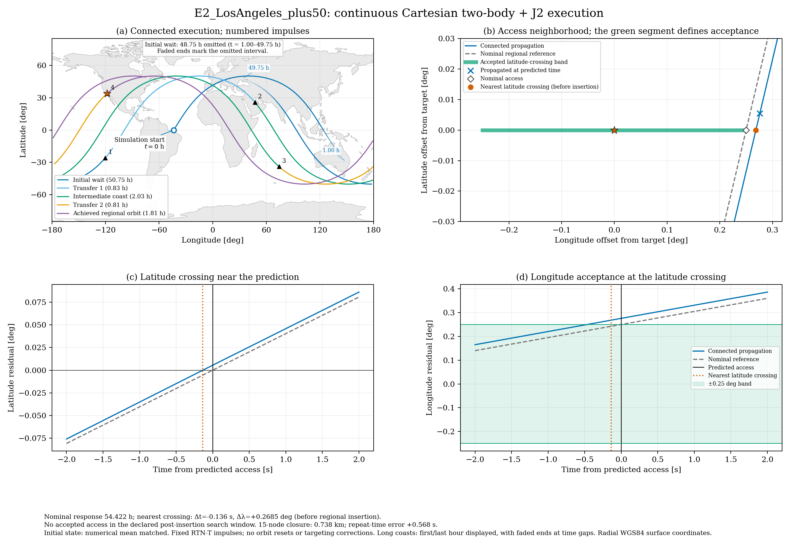

# Connected impulsive maneuver validation

The validator executes the nominal maneuver as one continuous Cartesian
trajectory. It first produces **one Los Angeles worked-example figure** and its
numerical evidence. It does not change the planner or generate a new manuscript.
The old `reconfig_maneuver_visualizer.py` remains an illustration of separately
initialized SGP4 arcs.

## Run the worked example

```bash
python -m pip install -r requirements-paper1-validation.txt
python -m unittest discover -s tests -v
python paper1_validate_maneuver.py \
  --config configs/paper1_validation_los_angeles.json \
  --output-dir results/paper1/validation-los-angeles
```

Run from the repository root with Python 3.10 or newer. NumPy, Matplotlib and
SciPy are sufficient; SGP4, Cartopy, online map downloads and external Earth
orientation files are not used. The land outlines are the existing cached
Natural Earth file under `reference/maps/`.

The saved example is E2: initial mean altitude 700 km, inclination 50 degrees,
drift offset +50 km, Los Angeles at 34.0522/-118.2437 degrees, and longitude
tolerance 0.25 degrees. The request is May 5, 2025, 12:00 UTC, with initial
node and phase zero. The 200 h wait and 300 h drift caps match the dense study.
The regional semimajor axis is solved from the 15/1 first-order secular repeat
condition, not copied from the legacy visualizer's hardcoded example.

## What is propagated

`reconfig_cartesian_validation.py` integrates inertial Cartesian position and
velocity with DOP853 under central gravity and unnormalized J2. The constants
are exactly those of the nominal planner: mu = 398600.4418 km^3/s^2,
J2 = 1.0826266e-3 and gravity reference radius 6371 km. This deliberately
retains the study's radius convention; it does not silently substitute another
Earth gravity model.

The corrected multicore planner runs with one worker and one requested
tolerance. Its wait, transfer and drift durations define the burn schedule.
Each nonzero Hohmann leg contributes a departure and arrival impulse. Their
signed magnitudes are fixed before propagation. At the scheduled time, the
impulse is applied along the instantaneous RTN transverse unit vector:

```text
r_after = r_before
v_after = v_before + delta_v_T * transverse_unit_vector
```

The resulting state starts the next propagation arc. No intermediate circular
orbit, final regional orbit, position or phase is imposed on the trajectory.
There is no numerical targeting correction. Coincident global/drift or
drift/regional orbits omit the corresponding two burns and transfer interval;
physical departure, insertion and access remain distinct when appropriate.
Two burns at the same epoch are applied sequentially without inserting a coast.

### Initial mean and osculating states

The default initial state is matched to the declared circular mean orbit by an
explicit numerical averaging convention. The code propagates a candidate
osculating state over a symmetric one-orbit interval, averages nonsingular
elements `[a, e*cos(omega), e*sin(omega), i, node, omega+M]`, and iterates the
epoch elements until their averages match the requested values. Node and phase
are unwrapped before averaging. This procedure has no target location or burn
sequence as an input and cannot fit the actual target miss away.

This is **not** an exact Brouwer-Lyddane, SGP4 or DSST mean-element conversion.
Its definition, averaging interval, residuals and initial Cartesian state are
stored in `summary.json`. The method separates an explicitly controlled initial
mean-state convention from integration error, but a multi-case study should
also assess its sensitivity. Setting `initialization` to `osculating` provides
a deliberately unmatched diagnostic, clearly labelled in the saved metadata.

### Frames and geographic events

The force model uses fixed inertial axes with the z axis aligned to the Earth
symmetry axis. Surface longitude uses the planner's continuous GMST function,
with UT1 approximated by UTC. Precession/nutation, polar motion, terrestrial
reference-frame refinements and SGP4's TEME frame are not introduced.

The primary latitude is the geodetic latitude of the **radial intersection of
the spacecraft's geocentric ray with the WGS84 ellipsoid**. This matches the
nominal planner's geodetic-to-geocentric target conversion. It is not the normal
projection associated with the spacecraft's geodetic coordinates at nonzero
altitude. Changing that surface-point definition would be a separate model
comparison, not an undocumented coordinate conversion.

Latitude crossings are found as integration events with dense-output root
refinement, independently of the 30 s plotting sample interval. At each crossing
the actual wrapped longitude residual is compared with the original requested
band. Crossings before regional insertion are retained as diagnostics and
cannot count as accepted access. No nearest miss is promoted to success.
The first accepted crossing, if one exists, is reported within the explicit
post-insertion window. The nearest crossing to the prediction is a separate
diagnostic, including its eligibility and time offset.

This first event formulation supports isolated, sign-changing latitude
crossings. Equatorial or grazing/tangent geometries require a different event
formulation before extending validation to those cases.

## Outputs and interpretation

- `validation_example.png` and `validation_example.svg`: **one figure in two
  formats**, showing the connected ground track, impulse locations, target
  close-up, and latitude/longitude residuals near predicted access. A dashed
  nominal regional reference is labelled as a mean-model reference. Long wait
  and drift coasts are propagated fully; only their first/last hour is plotted.
  A labelled marker identifies the simulation start. The visible coasts fade out
  and back in at each omitted interval, with endpoint times and the omitted
  duration labelled on the map. The gap is a display omission; no artificial
  ground-track connector is drawn across it.
- `summary.json`: scenario, nominal timings, initial-state convention, force
  model, actual access events, terminal osculating and numerical-mean elements,
  repeat closure, convergence comparison, versions and component source hashes.
- `latitude_crossings.csv`: all measured latitude-crossing events, including
  those before insertion and rejected events.
- `burns.json`: each actual pre/postburn state, commanded velocity change,
  position handoff residual and impulse residual.



The uncorrected saved case has a nominal response of about 54.4223 h. The
nominal solution uses the +0.25 degree band edge. The closest propagated
latitude crossing is about 0.136 s earlier and has a longitude residual of
approximately +0.268516 degrees: it is outside the band and occurs before the
scheduled regional insertion. No later accepted crossing is found in the
declared search window. **This is a physical acceptance failure of this raw
execution under the stated model, not a passed maneuver-accuracy claim.**

The measured postburn numerical-mean semimajor-axis error is about +39.7 m and
the numerical-mean eccentricity is about 9.45e-6. After 15 ascending-node
intervals the longitude closure corresponds to approximately 0.738 km, with an
actual repeat interval about 0.568 s longer than the nominal repeat interval.
Comparing surface points after the *nominal* repeat time gives a separate
approximately 4.35 km closure diagnostic; it includes the along-track timing
error. These two closure quantities must not be interchanged.

The nominal event has essentially no longitude margin because the optimizer
selects the earliest point inside the requested band. This single case therefore
shows why a small model discrepancy can change acceptance. It does not establish
a universal failure rate or attribute the discrepancy to one particular omitted
effect. Numerical targeting or a justified robustness margin would be follow-up
work, with any changes to time and delta-V reported explicitly.

## Numerical and physical controls

The core tests include a closed-form two-body two-transfer control, omitted
legs, coincident burns, circular-orbit access events, longitude wrap across the
antimeridian, J2 energy and axial-angular-momentum conservation, prograde and
retrograde element roundtrips, initial numerical-mean recovery, and node-indexed
repeat timing. Existing planner and analysis regression tests are retained.

The worked example is propagated again from the **identical Cartesian initial
state** with ten times tighter rtol/atol and a 30 s maximum step instead of 60 s.
The runner requires less than 0.1 m maximum sampled position discrepancy,
less than 0.001 s latitude-event discrepancy, equal event counts, and stable
accepted/failed status. All burn epochs are included in the sample comparison.
The saved example's maximum sampled position discrepancy is approximately
4e-5 m. This is a numerical convergence result, not the physical targeting error.

## Scope of the first output

This is one controlled two-body-plus-J2 worked example. It does not complete
the proposed 12-18 maneuver study, characterize request-state sensitivity, or
claim operational accuracy. Atmosphere, drag, solar radiation pressure, third
bodies, higher gravity harmonics, finite-duration thrust and execution errors
are not enabled. No spacecraft area, mass, drag coefficient or engine model has
been invented. Add those only with declared parameters and a separately stated
validation objective.

The source base commit is recorded in the configuration; the manifest hashes
the actual validation code, planner, coordinate helper and configuration used.
Rerun the command after changing any source file so the saved evidence and
manifest stay aligned.
